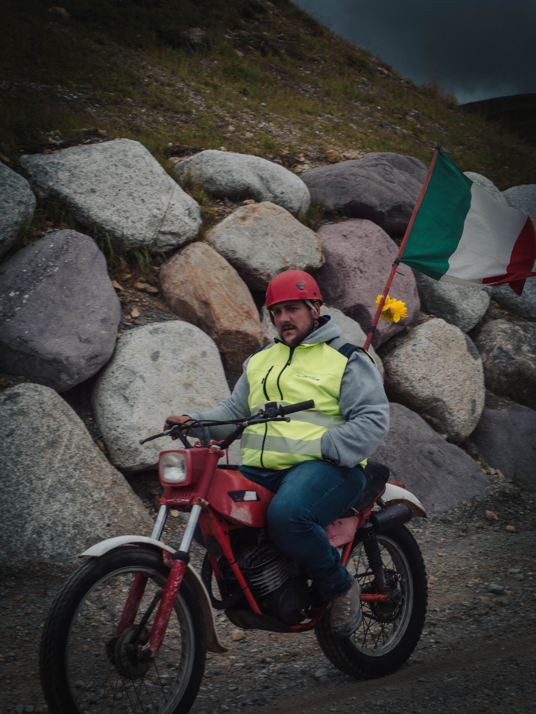

## Estate 2023

Come ogni nostra avventura vuole, bisogna poter improvvisare: così siamo partiti alla volta del Passo Crocedomini, senza nemmeno guardare le previsioni del tempo.

## Il luogo

Passo Crocedomini, situato in provincia di Brescia all'altitudine di 1892 m s.l.d.m., si trova a sud del Parco dell'Adamello. Il suo nome deriva dal latino "Croce del Dominio", poiché si trova al confine dei tre principali comuni che un tempo dominavano quelle valli: **Bagolino**, **Breno** e **Collio**.

Normalmente chiuso durante l'inverno per via della sua altitudine e della neve che cade, d'estate è un luogo perfetto per gite ed escursioni anche per i meno esperti.

## Perché proprio il Passo Crocedomini

Abbiamo scelto di recarci proprio al Passo Crocedomini perché mi trovavo a trascorrere la pausa estiva nel comune di Bagolino, che dista pochi chilometri. Si può raggiungere facilmente seguendo la strada per la **Piana del Gaver** e proseguendo verso il passo, oppure passando per il **Monte Maniva**.

Partiti con un'auto e gli zaini in spalla, siamo andati a fare una camminata con l'obiettivo di raggiungere "i radar" (l'ex base NATO situata vicino alla punta Dasdana), dimenticando il fatto che la strada non è breve e che il tempo atmosferico non era a nostro favore.

## L'inizio della fine

Iniziamo la nostra camminata, inconsapevoli della distanza da percorrere, e subito ci accorgiamo della temperatura relativamente bassa. Ovviamente non saremmo noi se fossimo stati perfettamente attrezzati per la situazione, ma proseguiamo comunque.

Dopo qualche chilometro percorso a piedi incrociamo qualche motociclista, probabilmente intento a una rievocazione storica data l'età delle moto e per come erano vestiti. Sicuramente un incontro fuori dal comune, ma che strappa un sorriso.

## Cosa sapere prima di partire

Se l'idea è quella di arrivare fino ai radar, qualche accortezza fa la differenza:

- **Calcola bene la distanza**: la strada non è breve e il dislivello si sente, soprattutto se si parte tardi.
- **Guarda il meteo**: in quota il tempo cambia in fretta e la temperatura può essere più bassa di quanto ci si aspetti.
- **Parti attrezzato**: scarpe adatte, acqua e uno strato in più non sono mai un peso.

Sono errori che abbiamo fatto noi al posto vostro: meglio imparare dalla nostra improvvisazione che ripeterla.

## Ma com'è finita?

Ovviamente vi starete chiedendo se siamo riusciti a raggiungere il nostro obiettivo. Questo non ve lo svelo direttamente qui, ma vi invito a vedere il video correlato sul nostro canale YouTube.

  <iframe
    src="https://www.youtube.com/embed/qNTTg-JgfTA"
    title="ESCURSIONE PASSO CROCEDOMINI - Non siamo più fatti per camminare"
    width="800"
    height="450"
    loading="lazy"
    allowfullscreen
  ></iframe>

Sicuramente saprà raccontarlo in modo più epico e divertente di quanto io possa scrivere.
