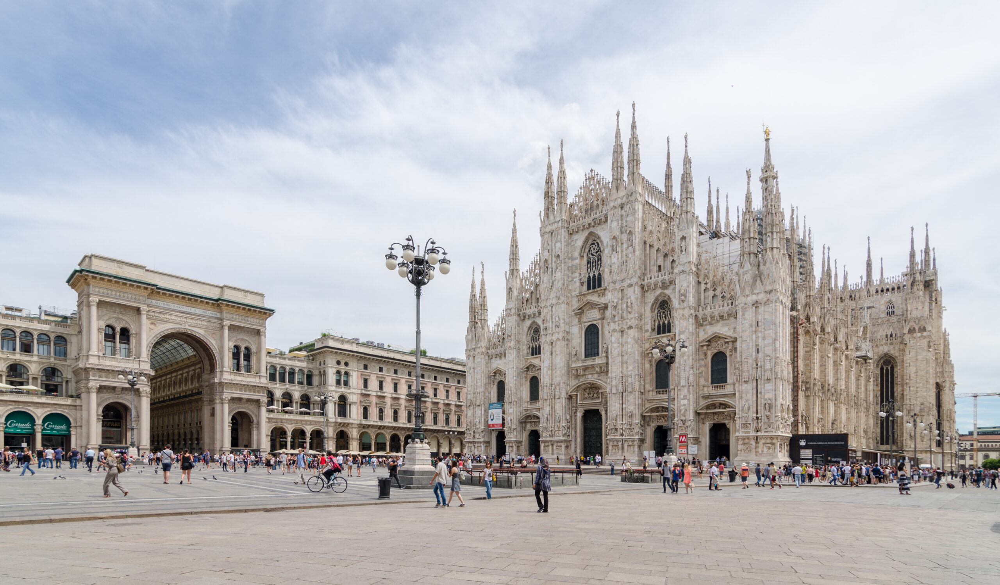
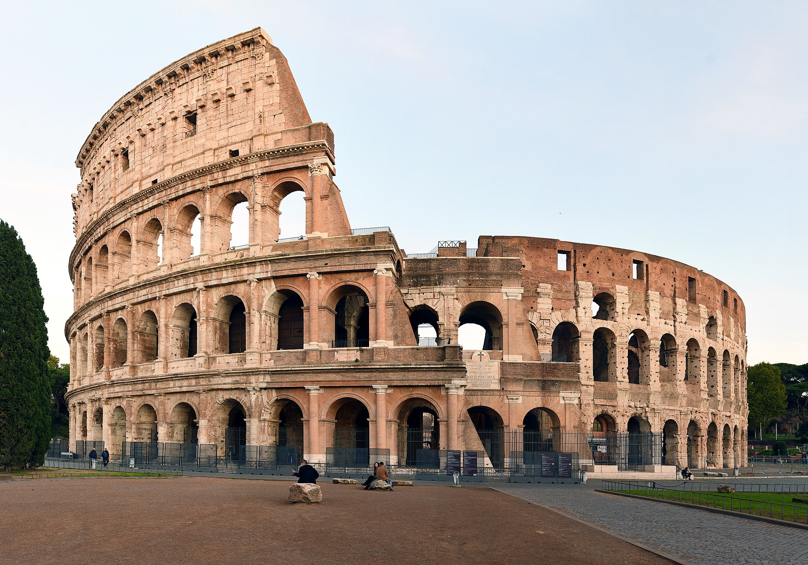
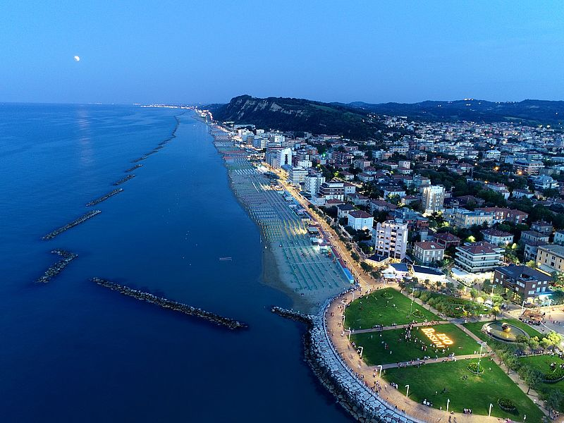
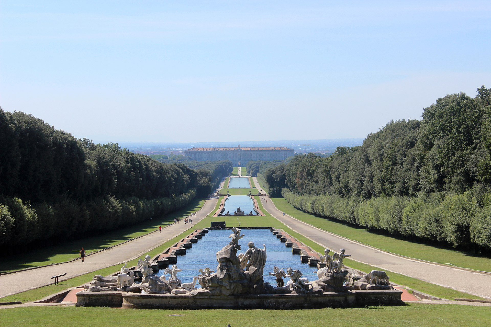
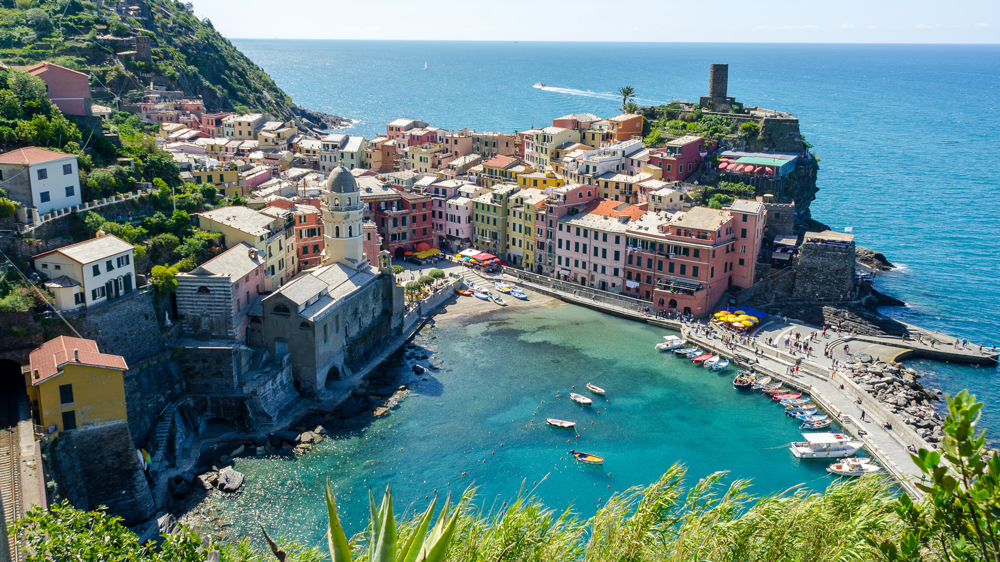

L'Italia è un luogo favoloso, pieno di posti e città da scoprire. Non basterebbe un'intera vita per visitare e conoscere la storia di tutti i luoghi che hanno reso l'Italia famosa nel mondo come **"Il Belpaese"**.

Come non sarebbe possibile visitare tutte le città del Belpaese in un'intera vita, non è nemmeno possibile scrivere una lista che le comprenda tutte. Con questa top 5 non vogliamo dare una vera e propria posizione alle città elencate, ma far scoprire o riscoprire alcune città che meritano di essere visitate durante questo 2024.

> **In sintesi** — Cinque mete molto diverse tra loro: due grandi città d'arte (Milano e Roma), una capitale italiana della cultura (Pesaro), una reggia con il suo parco (Caserta) e un tratto di costa unico (le Cinque Terre). Un itinerario ideale per chi vuole alternare storia, cultura e cucina.

## 1. Milano

Al primo posto troviamo una delle metropoli europee più famose del mondo. Milano, con oltre un milione di abitanti, si è candidata tra le **24 città più trendy secondo Airbnb**. Da sempre una città ricca di luoghi d'importanza storica e culturale. Ogni anno è meta di fiere internazionali come quelle di moda e arredamento.

Di questa città si cita sempre il suo famoso **Duomo**, situato in una meravigliosa piazza, ma spesso ci si scorda di come Milano sia ricca anche di altri luoghi famosi, come il **Castello Sforzesco** oppure il **Museo Nazionale Scienza e Tecnologia Leonardo da Vinci**.

È una città che cambia continuamente: le stesse fiere che la rendono famosa nel mondo sono anche un ottimo pretesto per tornarci, perché ogni periodo dell'anno porta con sé eventi e allestimenti diversi.

## 2. Roma

Al secondo posto, ma non sicuramente in ordine d'importanza, troviamo la città di Roma.

Famosa in tutto il mondo per il **Colosseo**, un imponente anfiteatro romano, questa città merita di essere visitata solo per la storia che la circonda. Non solo possiamo trovare la bellezza delle **rovine dell'impero romano**, ma anche andare a visitare uno degli stati più famosi al mondo per la sua importanza religiosa: **lo Stato del Vaticano**.

Oltre a offrire tantissimi musei e punti storici da visitare, Roma mantiene anche un'importante cultura culinaria, con uno dei piatti forse più amati in tutto il mondo: la **carbonara**. Tra una passeggiata e l'altra, la cucina romana è una delle ragioni per cui vale la pena fermarsi qualche giorno in più.

## 3. Pesaro

Questa città entra a far parte di questa lista per via di un avvenimento molto importante: durante il 2024 Pesaro è la **capitale italiana della cultura**, un riconoscimento che viene assegnato ogni anno e che permette di far scoprire a turisti italiani e internazionali la cultura di una città, organizzando eventi e promuovendo il **turismo sostenibile**.

Pesaro è situata sulla costa italiana e si affaccia sul **mare Adriatico**. Ricca di punti d'interesse, nella città si può notare una forte influenza del periodo rinascimentale italiano.

Proprio l'essere capitale della cultura la rende una meta particolare nel 2024: un programma fitto di mostre, spettacoli ed eventi che difficilmente si ritrova in altre città nello stesso periodo.

## 4. Caserta

Un'altra città che merita di essere visitata è Caserta. Famosa in tutto il mondo per la **Reggia di Caserta**, una nota meta turistica dove è possibile visitare i suoi interni e i suoi giardini.

Oltre alla famosa Reggia, a Caserta è possibile visitare la sua **città vecchia**, apprezzare la cucina locale e soprattutto, data la sua vicinanza con **Napoli**, assaggiare la famosissima e autentica **pizza napoletana**, diventata patrimonio Unesco.

La posizione è uno dei suoi punti di forza: si presta bene come base per esplorare i dintorni, tra Napoli e le bellezze della Campania.

## 5. Le Cinque Terre

Anche se non si tratta di una singola città, le **Cinque Terre** meritano di essere visitate almeno una volta nella vita.

Situate in Liguria nel **Parco Nazionale delle Cinque Terre**, le cinque città che le compongono un tempo erano villaggi di pescatori. Ad oggi sono una meta gettonata soprattutto durante il periodo estivo, offrendo viste stupefacenti sul **Mar Ligure** e un tuffo nella cultura balneare italiana. Questi antichi villaggi permettono di scoprire le tradizioni della cucina ligure.

## In conclusione

In Italia è possibile scoprire **borghi** e **paesi** meravigliosi, ognuno con le sue tradizioni e culture locali. Esplorando e visitando queste città, bisogna lasciarsi andare alla vita frenetica di tutti i giorni e godere di quei pochi momenti che ci permettono di ricollegarci con le nostre radici: assaporare la cultura e le tradizioni nella bellezza del nostro paese.

Se dovessimo dare un consiglio pratico, è quello di distribuire queste mete nel tempo invece di rincorrerle tutte insieme: le città d'arte come Milano e Roma si godono meglio in primavera o in autunno, mentre le Cinque Terre danno il meglio fuori dal picco estivo, quando i sentieri e i borghi sono più vivibili.
